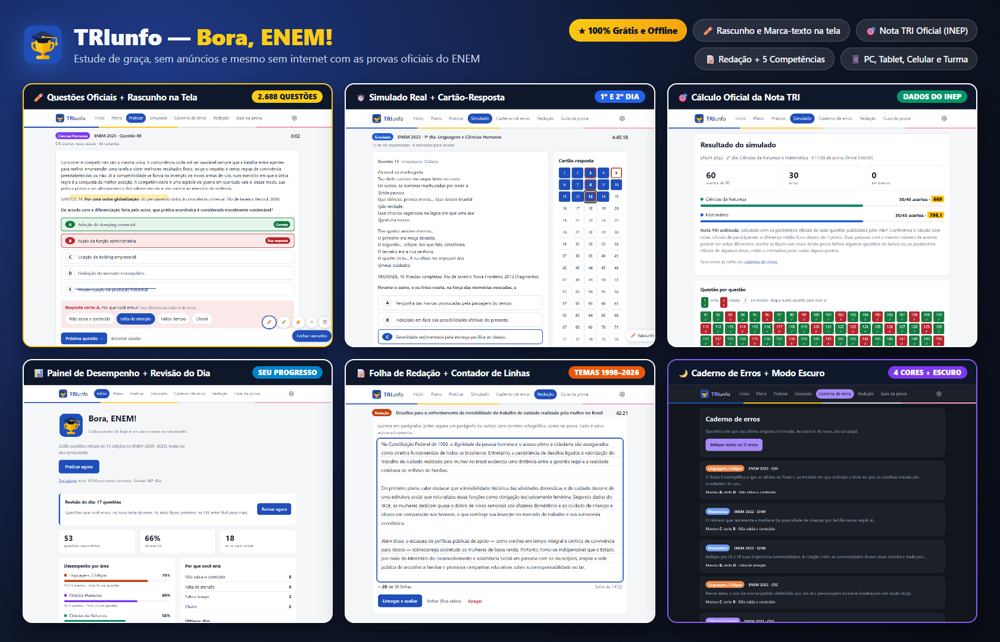
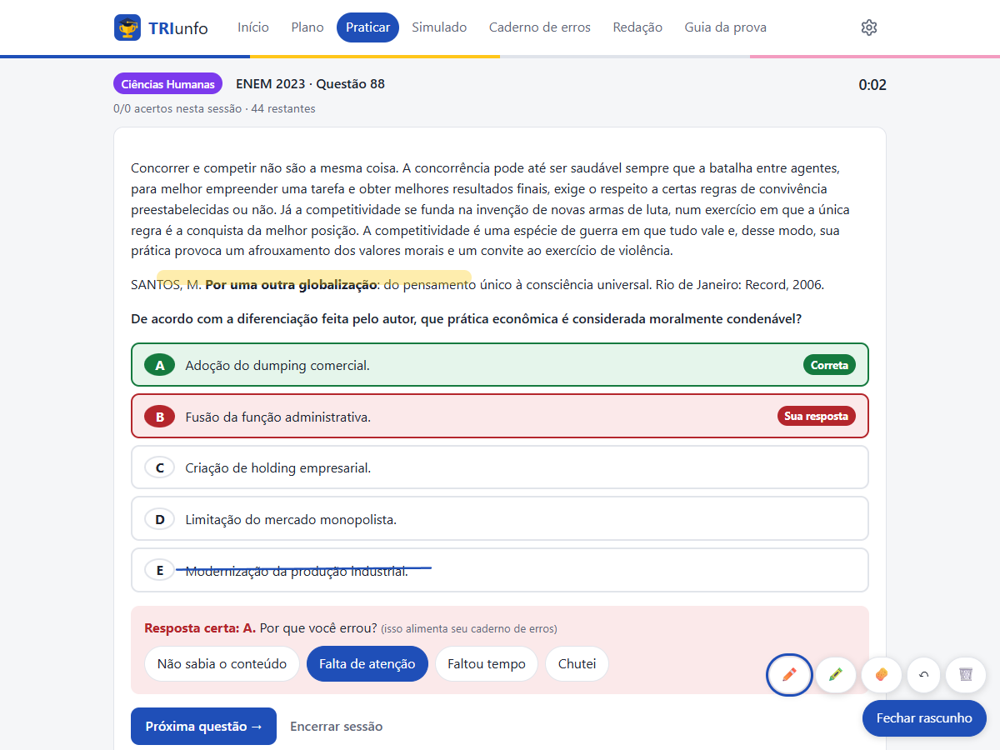
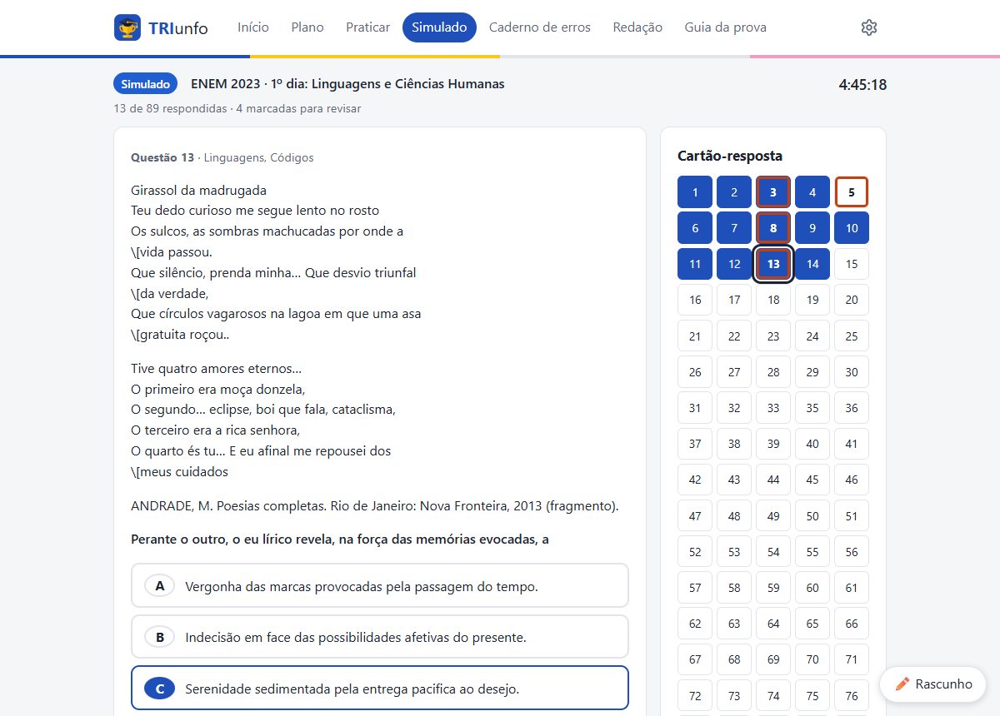
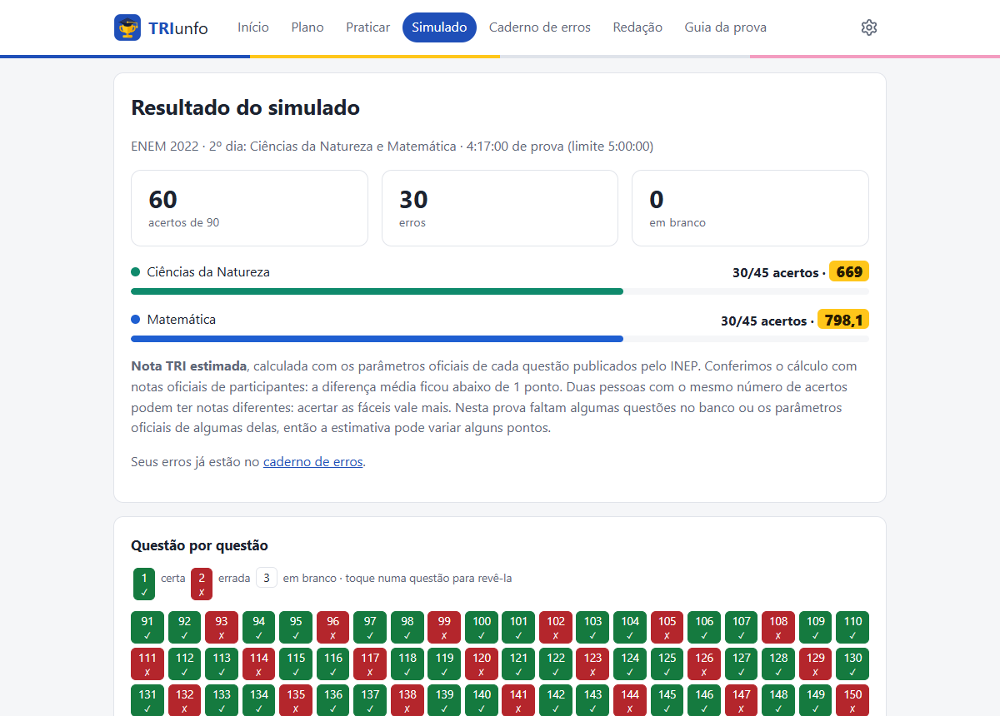
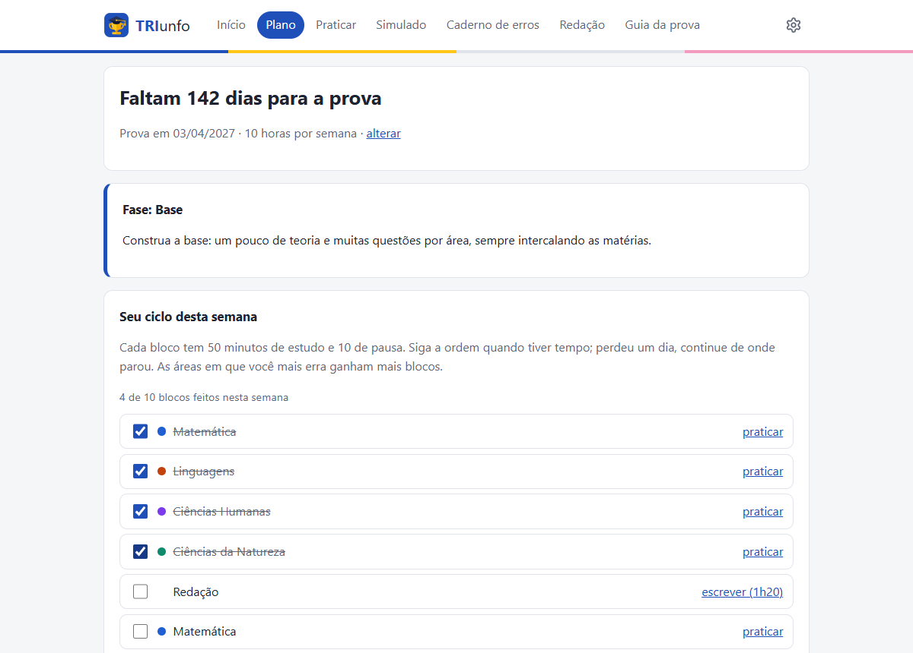
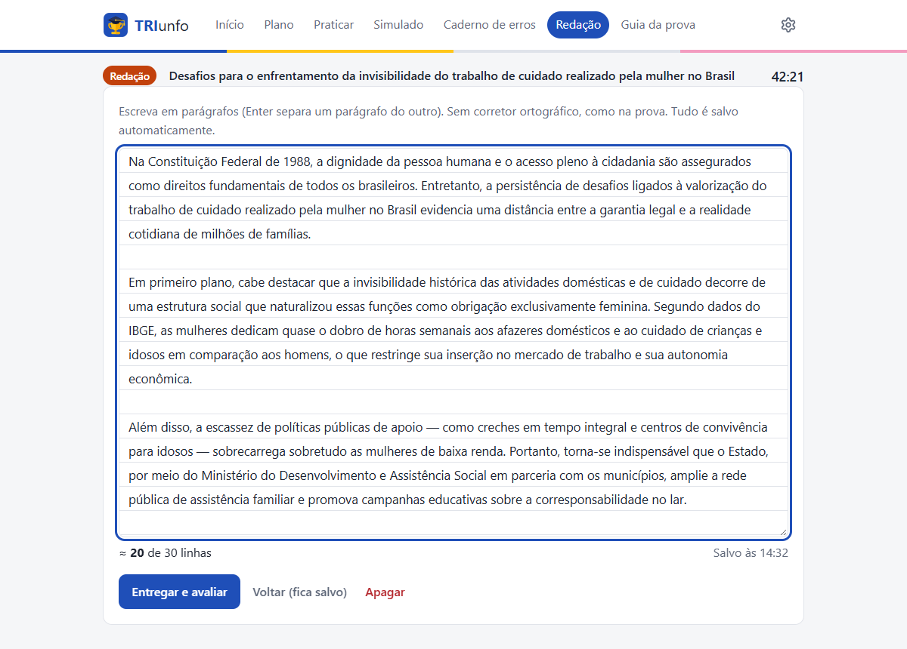
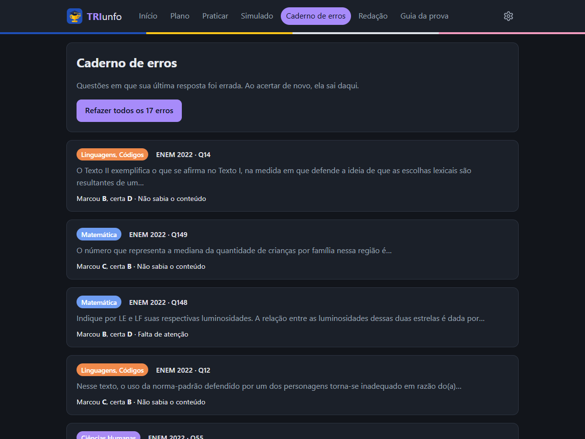

# 🏆 TRIunfo — Bora, ENEM!

**A plataforma 100% gratuita, sem anúncios e que funciona sem internet para você estudar de verdade e mandar bem no ENEM.**

[](https://github.com/geniels/triunfo-enem/releases/latest)
[-047857?style=for-the-badge)](#como-instalar-e-começar-em-1-minuto-windows)
[](LICENSE)



---

## 💡 Por que criamos o TRIunfo?

Se você estuda sozinho para o ENEM, provavelmente já passou por isso: questões espalhadas em dezenas de sites, plataformas que cobram mensalidade para liberar o gabarito, propagandas que tiram sua concentração ou a internet caindo bem na hora de estudar.

O **TRIunfo** nasceu para ajudar a comunidade de estudantes que precisa de uma ferramenta **boa, completa e totalmente de graça**:

- 🆓 **De graça para sempre:** sem mensalidades, sem plano VIP, sem anúncios e sem pedir cartão ou cadastro na internet.
- 📴 **Funciona 100% sem internet:** tudo já vem dentro do programa (2.688 questões oficiais, imagens e cálculo da nota). Instalou, estudou!
- 💻 **Roda em qualquer PC:** super leve, pensado para funcionar rápido até em computadores antigos ou modestos.
- 📱 **No PC, no celular, no tablet ou com a turma:** estude no computador, continue deitado no sofá pelo celular/tablet (no mesmo Wi-Fi) ou monte um grupo de estudos na escola ou cursinho popular.

> **De onde vem o nome?** Junta a **TRI** (*Teoria de Resposta ao Item*, o método oficial que calcula a sua nota no ENEM) com o seu **triunfo** na aprovação!

---

## 🚀 Como instalar e começar em 1 minuto (Windows)

Você não precisa configurar nada nem entender de computador:

1. 👉 **[Clique aqui para abrir a página de download](https://github.com/geniels/triunfo-enem/releases/latest)** e baixe o arquivo **`TRIunfo-Estudante-....exe`**.
2. Dê **dois cliques** no arquivo baixado e avance até terminar (não pede senha de administrador).
3. Abra pelo atalho **TRIunfo ENEM** na sua Área de Trabalho ou no Menu Iniciar. Pronto, ele abre direto no seu navegador!

> 💡 **Apareceu uma tela azul dizendo *"O Windows protegeu o computador"*?**
> Pode ficar tranquilo! Isso só aparece porque o instalador ainda está na fila para receber a assinatura digital gratuita de projetos abertos. Basta clicar em **Mais informações** e depois em **Executar assim mesmo**.

---

## 🖼️ Veja o programa funcionando (clique nas imagens para ampliar)

<table>
  <tr>
    <td width="50%" valign="top">
      <h3>✏️ 1. Questões oficiais + Rascunho na tela</h3>
      <a href="docs/imagens/pratica.png">
        
      </a>
      <p>
        Resolva <b>2.688 questões oficiais (2009–2023)</b> filtrando por matéria, ano e idioma. Use a <b>caneta</b> e o <b>marca-texto</b> para grifar o enunciado e riscar alternativas descartadas direto na tela! Ao errar, marque o motivo (<i>conteúdo, atenção, tempo ou chute</i>).
      </p>
    </td>
    <td width="50%" valign="top">
      <h3>⏱️ 2. Simulado real + Cartão-resposta</h3>
      <a href="docs/imagens/simulado.png">
        
      </a>
      <p>
        Treine o <b>1º dia (5h30)</b> e o <b>2º dia (5h)</b> na ordem exata do caderno oficial. Empacou numa questão difícil? Clique em <b>Marcar para revisar</b> (ela fica laranja no cartão-resposta) para fazer as fáceis primeiro e voltar nela depois!
      </p>
    </td>
  </tr>
  <tr>
    <td width="50%" valign="top">
      <h3>🎯 3. Sua Nota TRI calculada como no ENEM</h3>
      <a href="docs/imagens/nota-tri.png">
        
      </a>
      <p>
        Ao entregar o simulado, o TRIunfo calcula sua <b>Nota TRI oficial</b> usando os dados públicos do INEP (diferença média menor que 1 ponto em relação às notas reais). Clique em qualquer questão do gabarito para rever sua resposta e seus rascunhos.
      </p>
    </td>
    <td width="50%" valign="top">
      <h3>📅 4. Plano de estudos que não trava sua rotina</h3>
      <a href="docs/imagens/plano.png">
        
      </a>
      <p>
        Informe a data da prova e quantas horas livres você tem na semana. O programa monta um <b>ciclo de blocos de 50 min</b> que coloca mais tempo nas matérias em que você mais erra. Perdeu um dia? Sem culpa: é só continuar do próximo bloco!
      </p>
    </td>
  </tr>
  <tr>
    <td width="50%" valign="top">
      <h3>📝 5. Folha de Redação + 5 Competências</h3>
      <a href="docs/imagens/redacao.png">
        
      </a>
      <p>
        Todos os <b>temas oficiais de 1998 a 2026</b> (ou tema livre), folha pautada sem corretor ortográfico, cronômetro de <b>1h20</b> e contador de linhas (avisa abaixo de 8 e acima de 30). Depois de entregar, faça a <b>autoavaliação guiada de 0 a 1000 pontos</b>!
      </p>
    </td>
    <td width="50%" valign="top">
      <h3>🌙 6. Caderno de Erros, Revisão e Modo Escuro</h3>
      <a href="docs/imagens/escuro.png">
        
      </a>
      <p>
        Tudo o que você erra vai sozinho para o <b>Caderno de erros</b> e volta na <b>Revisão do dia</b> após <b>1, 3, 7 e 21 dias</b> (sempre começando pelas mais fáceis, que valem mais na TRI). Escolha entre tema claro, escuro e 4 cores de destaque!
      </p>
    </td>
  </tr>
</table>

---

## 📋 Resumo de tudo o que você encontra no TRIunfo

- **Painel de Desempenho completo ([veja a tela inicial](docs/imagens/inicio.png)):** acompanhe sua porcentagem de acertos e seu tempo médio por questão em cada área, descubra se você erra mais por falta de conteúdo ou falta de atenção e veja seu ritmo nos últimos 14 dias.
- **Guia da Prova (o Edital traduzido):** horários dos portões, quais documentos digitais valem, qual caneta levar, o que elimina na hora e o que dá nota zero na redação — sempre atualizado com o edital oficial.
- **Estude no celular/tablet ou em Turma (Wi-Fi):**
  - **No seu celular ou tablet:** vá em *Configurações → Outros aparelhos e turma*, crie seu nome e PIN e clique em *Abrir acesso pela rede*. Digite o endereço no navegador do celular (no mesmo Wi-Fi) para estudar com o **mesmo progresso do PC**.
  - **Com amigos, cursinho ou escola (Modo Turma):** um computador abre a turma na rede Wi-Fi e cada estudante entra pelo próprio celular ou PC com seu nome e PIN de 4 dígitos, mantendo o progresso separado para cada pessoa.
- **Acessibilidade de verdade:** atalhos rápidos no teclado (`A`–`E` escolhem a alternativa, `Enter` confirma, `←` `→` mudam de questão e `M` marca para revisão), suporte a leitores de tela e selos em texto além de cores para quem tem daltonismo.

---

## 🔒 Privacidade: seus estudos pertencem só a você

- Tudo fica salvo **somente no seu computador** (respostas, rascunhos, simulados, redações e plano).
- Nada do que você escreve ou responde é enviado para servidores na internet ou usado para treinar inteligência artificial (respeito total à **LGPD**).
- A internet só é usada se você clicar em **Verificar atualizações** (ou uma vez por dia para avisar se saiu versão nova, opção que pode ser desligada em Configurações).

Veja os detalhes na nossa [Política de Privacidade](PRIVACIDADE.md).

---

## 🤝 Como contribuir com o projeto

O **TRIunfo** é feito de forma aberta e colaborativa. Qualquer pessoa pode ajudar a melhorar a plataforma para mais estudantes!

### 🎓 Sou estudante ou professor (não sei programar)
Você ajuda — e muito! — fazendo qualquer uma destas coisas:
1. **Avisar sobre erros em questões:** achou uma questão com texto quebrado ou imagem faltando? Anote o **ano** e o **número da questão** e conte para a gente abrindo uma [Issue aqui no GitHub](https://github.com/geniels/triunfo-enem/issues).
2. **Dar ideias de estudo:** sente falta de alguma função que ajudaria sua rotina ou sua turma? Abra uma [Issue](https://github.com/geniels/triunfo-enem/issues) com a sua sugestão!
3. **Atualizar o Guia da Prova ou Temas de Redação:** o guia da prova é um texto simples em [`app/conteudo/guia.md`](app/conteudo/guia.md) e os temas de redação ficam em [`app/conteudo/redacao.json`](app/conteudo/redacao.json).
4. **Divulgar para quem precisa:** indique o TRIunfo para colegas de escola, grêmios estudantis, professores da rede pública e cursinhos comunitários!

### ☕ Apoie o projeto (doação voluntária)

O **TRIunfo é e sempre será 100% gratuito e sem anúncios**. Se você é estudante, sua única missão é estudar, fazer os simulados e conquistar sua vaga — o melhor jeito de retribuir é compartilhando o projeto com seus amigos!

Mas se você já trabalha, foi aprovado com a ajuda do TRIunfo, é professor ou acredita na educação aberta e quiser apoiar voluntariamente a manutenção do projeto (como custos de certificado digital e desenvolvimento), pode contribuir com qualquer valor via **Pix (chave aleatória)**:

```text
8e5b8763-dbfe-45b5-8399-e2631a5dac94
```

*(Voluntary, non-commercial donation to support open-source maintenance.)*

### 💻 Sou desenvolvedor(a) e quero contribuir com código

Antes de enviar código, leia o [`CLAUDE.md`](CLAUDE.md) e as decisões de arquitetura em [`docs/adr/README.md`](docs/adr/README.md). Toda contribuição segue quatro regras de ouro:
- **Zero complicação para o estudante:** na edição Estudante, nada de exigir terminal, variáveis de ambiente ou chaves ([ADR 0010](docs/adr/0010-edicoes-estudante-e-escola.md)).
- **100% offline e leve:** frontend em HTML, CSS e JavaScript puros, sem CDN e sem etapa de build ([ADR 0002](docs/adr/0002-app-web-local-offline.md)).
- **Gabarito protegido:** a resposta certa nunca vai ao navegador antes de o aluno confirmar a resposta ou entregar o simulado ([ADR 0003](docs/adr/0003-fonte-de-dados-e-correcoes.md)).
- **Acessibilidade obrigatória:** qualquer tela nova deve funcionar por teclado, ter foco visível e não comunicar informação apenas por cor ([ADR 0005](docs/adr/0005-acessibilidade-como-requisito.md)).

#### Como rodar no seu computador

Com o **Python 3.12+** instalado no Windows, dê dois cliques em **`iniciar.bat`**: ele prepara o ambiente, baixa as questões, as imagens e os parâmetros da nota TRI na primeira vez e abre `http://localhost:8000`.

Manualmente pelo terminal (Windows, Linux ou macOS):

```bash
python -m venv .venv
.venv/bin/pip install -r requirements.txt        # Windows: .venv\Scripts\pip install -r requirements.txt
.venv/bin/python scripts/importar_enem_dev.py    # Questões e imagens (enem.dev)
.venv/bin/python scripts/importar_tri.py         # Parâmetros da nota TRI (microdados do INEP, ~30 MB)
.venv/bin/python -m uvicorn app.main:app --port 8000
```

Rodar os testes automatizados antes de abrir um *Pull Request*:

```bash
.venv/bin/python -m unittest discover tests      # Windows: .venv\Scripts\python.exe -m unittest discover tests
```

Gerar o instalador `.exe` no Windows (requer o [Inno Setup 6](https://jrsoftware.org/isinfo.php)):

```powershell
.\.venv\Scripts\python.exe instalador\construir.py
```

<details>
<summary><b>📂 Ver a estrutura de pastas do projeto</b></summary>

```text
app/main.py            API (FastAPI) e servidor da interface web local
app/db.py              Bancos SQLite: data/questoes.db (conteúdo) e data/aluno.db (progresso do estudante)
app/tri.py             Cálculo da nota TRI (modelo logístico de 3 parâmetros, estimativa EAP)
app/revisao.py         Calendário da revisão espaçada (1, 3, 7 e 21 dias)
app/plano.py           Gerador do plano de estudos em ciclo semanal
app/redacao.py         Regras de validação e autoavaliação da redação
app/turma.py           Servidor e controle de acesso do Modo Turma na rede local
app/guia.py            Guia da prova e sincronização sob demanda
app/versao.py          Verificação de versão nova e atualização em 1 clique
app/conteudo/          Texto do Guia da prova (Markdown) e temas/competências da redação (JSON)
app/static/            Interface (HTML, CSS e JavaScript puros, incluindo rascunho.js e markdown.js)
scripts/               Importadores de questões (enem.dev) e de parâmetros TRI (microdados do INEP)
instalador/            Lançador, script de empacotamento e configuração do Inno Setup
tests/                 Testes automatizados (API, banco de dados, TRI, modo turma e segurança)
docs/                  Roteiro (ROADMAP.md), imagens e Registros de Decisão de Arquitetura (docs/adr/)
```
</details>

---

## 🗺️ Roteiro do projeto

| Fase | O que inclui | Status |
|---|---|---|
| **1** | Banco de questões (2009–2023), prática com filtros, rascunho com caneta, caderno de erros e painel | ✅ Pronta |
| **2** | Simulado oficial por dia, cálculo da nota TRI, revisão espaçada e plano de estudos em ciclo | ✅ Pronta |
| **3** | Redação: temas oficiais, folha pautada e autoavaliação ✅ · apoio por IA local opcional ⏳ | ▶️ Em andamento |
| **4** | Modo Turma na rede Wi-Fi ✅ · acesso pelo próprio tablet/celular ✅ · painel do organizador por área ⏳ | ▶️ Em andamento |
| **5** | Instalador Windows ✅ · atualização em 1 clique ✅ · provas 2024/2025 e filtro por assunto ⏳ | ▶️ Em andamento |

O roteiro detalhado está em [`docs/ROADMAP.md`](docs/ROADMAP.md).

---

## 🔏 Assinatura de código

O instalador é gerado de forma automática e pública no GitHub Actions, a partir deste repositório. O projeto está se candidatando à assinatura gratuita para código aberto da **SignPath Foundation**: depois de aprovado, as versões virão com *free code signing provided by [SignPath.io](https://signpath.io), certificate by [SignPath Foundation](https://signpath.org)*.

---

## 📚 Fontes dos dados e Licença

- **Provas, gabaritos, editais e microdados (parâmetros TRI):** [INEP](https://www.gov.br/inep/pt-br/areas-de-atuacao/avaliacao-e-exames-educacionais/enem) (dados públicos oficiais).
- **Questões estruturadas:** projeto comunitário aberto [enem.dev](https://enem.dev) (algumas imagens ausentes na fonte aparecem como *"imagem indisponível"*).
- **Licença:** **[MIT](LICENSE)** — uso, cópia e modificação totalmente livres, inclusive por estudantes, escolas públicas, cursinhos populares e órgãos públicos.
